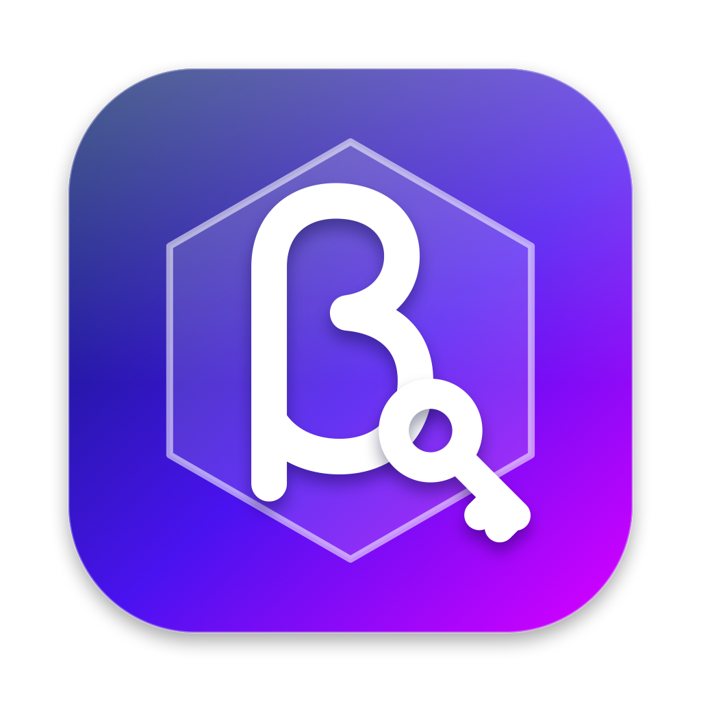

<p align="center">
  
</p>

# Omnissa Beta Token Utility

Get Apple beta enrollment tokens (AppleSeed for IT) and use them in a
Workspace ONE UEM declarative **Software Update: Settings** profile, so managed
Apple devices can enroll in a beta program.

**All Rust.** The CLI and the macOS app share one core in `rust/`. Build with
`cargo`. Version comes from `rust/Cargo.toml`.

| Format | For | Needs |
|---|---|---|
| **Rust CLI** (`omnissa-beta-tokens-<ver>-macos-arm64`) | Command line | Apple Silicon Mac |
| **macOS app** (egui `.app`) | Admins who want a window | macOS 13 or later |

> **Status: pre-release (0.1.0).** Builds are not yet signed or notarized by
> Omnissa, so macOS shows a Gatekeeper warning on first launch (see below). The
> beta token retrieval has been tested against a live Apple Business
> organization. How devices behave after receiving the profile is still being
> validated; see [Known gaps](#known-gaps).

## Download

Get the latest files from the **Releases** page of this repository:

- `omnissa-beta-tokens-<version>-macos-arm64`: Rust CLI
- `Omnissa-Beta-Token-Utility-<version>-macos.zip`: Rust (egui) macOS app
- `omnissa-beta-guide-<version>.html`: the step-by-step guide (works offline)
- `SHA256SUMS`: checksums for all of the above

Version for releases is taken from `rust/Cargo.toml`. Verify what you
downloaded, or build from source (`cd rust && cargo build --release`):

```bash
shasum -a 256 -c SHA256SUMS
```

### First launch on macOS

Until the app is signed and notarized, macOS blocks it the first time. Either
right-click the app and choose **Open**, or remove the quarantine flag:

```bash
xattr -d com.apple.quarantine "Omnissa Beta Token Utility.app"
```

## How it works

1. **Create a certificate.** `init` generates a key and a self-signed
   certificate (`.pem`) on your Mac.
2. **Add an external device management service in Apple Business.** Upload the
   `.pem` and download the `.p7m` server token. Use the service name
   `Workspace One Beta Token Service`; the app and CLI copy it to your clipboard.
3. **Fetch the beta programs.** `fetch` decrypts the server token locally,
   signs a request to Apple's `mdmenrollment.apple.com` service, and lists the
   programs. Optionally print a UEM paste block with `--uem-block`.
4. **Use a token in Workspace ONE UEM.** Enter the title and token in Software
   Update: Settings > Beta, using a valid mode combination (field guidance only;
   this tool does **not** emit declaration JSON).
5. **Clean up.** Delete the management service in Apple Business, then run
   `cleanup` to remove local key/cert/`.p7m` files.

The full walkthrough, with screenshots, is in [docs/guide.md](docs/guide.md).

## Quick start

**App:** open it, choose **Create certificate**, upload the `.pem` in Apple
Business, choose the downloaded `.p7m`, then **Fetch beta tokens**. Same Rust
core as the CLI.

**Command line:**

```bash
omnissa-beta-tokens init                      # key + certificate in ~/.omnissa-beta-tokens
omnissa-beta-tokens fetch --watch             # waits for the .p7m in ~/Downloads
omnissa-beta-tokens fetch --p7m token.p7m --os macOS --reveal
omnissa-beta-tokens fetch --match "macOS 27" --format json
omnissa-beta-tokens fetch --os macOS --match "27" --uem-block
omnissa-beta-tokens cleanup --yes             # delete local key/cert/*.p7m; still remove ABM service
```

### CLI reference

| Command / flag | Purpose |
|---|---|
| `init` | Generate private key + `.pem` under `--workdir` (default `~/.omnissa-beta-tokens`) |
| `fetch` | Decrypt `.p7m`, call Apple, list beta programs |
| `fetch --p7m PATH` | Use a specific server token |
| `fetch --watch` | Wait for a new `.p7m` in `~/Downloads` |
| `fetch --os` / `--match` | Narrow the program list |
| `fetch --format table\|json\|csv` | Output shape (JSON/CSV include full tokens) |
| `fetch --reveal` | Show full tokens in the table |
| `fetch --uem-block` | Print (and copy) Title/Token + Mode field checklist for **exactly one** matched program — not declaration JSON |
| `cleanup` | Delete `mdm_private.key`, `mdm_public_cert.pem`, and `*.p7m` in `--workdir` |
| `cleanup --yes` | Skip interactive confirm (required when stdin is not a TTY) |

## Modes (UEM field guidance only)

Apple's `softwareupdate.settings` schema allows only these combinations in the
UEM Beta payload. Enter them in the console (the app Mode picker and
`fetch --uem-block` show the same summary). **This project does not generate
DDM / declaration JSON** — paste title and token, then set the fields below.

| Mode | Program enrollment | Require program | Offer programs |
|---|---|---|---|
| Automatic | AlwaysOn | On | Off |
| Offer to user | Allowed | Off | On |
| Offer, no sign-in | AlwaysOn | Off | On |
| Block and unenroll | AlwaysOff | Off | Off |

The Beta setting needs **supervised** devices: macOS 15.4 or later, and iOS or
iPadOS (the schema lists the Software Update Settings payload from iOS 18.0).
It is not available on tvOS or visionOS. The organization must be enrolled in
[AppleSeed for IT](https://beta.apple.com/for-it); otherwise Apple returns 403
`APPLE_SEED_FOR_IT_TURNED_OFF`. Tokens are per organization and per seeding
period.

## Security

- OAuth secrets are never printed or logged; they appear as `[REDACTED]`.
- The decrypted server token is kept in memory only. No plaintext copy is written.
- The work folder is mode 700 and the private key mode 600.
- Beta tokens are masked on screen unless you choose to reveal them. JSON and CSV
  output include full tokens because they are for export.
- Treat the `.p7m` and the private key as credentials. When you are finished,
  delete the management service in Apple Business and run
  `omnissa-beta-tokens cleanup --yes`.
- `*.p7m`, `*.pem` and `*.key` are git-ignored. Never commit them.

The tool talks only to `mdmenrollment.apple.com`. It needs no account on
anything else and sends nothing elsewhere.

## Known gaps

- **On-device validation:** which devices enroll, and what users see in Software
  Update, has not been validated end to end on a supervised Mac or iPhone. The
  guide includes an on-device checklist scaffold for that work.
- **UEM screenshot:** the guide still uses a placeholder for Software Update:
  Settings > Beta (Automatic). Capture with the token redacted before external
  sharing.
- **Notarization / Developer ID:** builds are ad-hoc signed only. Gatekeeper
  warns on first launch until a Developer ID–signed and notarized app ships.
- **Private distribution:** the repository and releases are private; there is no
  public download channel yet.
- The app icon and styling have not been through an Omnissa brand review.

## Build from source

```bash
cd rust
cargo test
cargo build --release
# CLI: rust/target/release/omnissa-beta-tokens
```

The macOS `.app` is the same Rust core (egui UI). Package/release steps and
signing are in [docs/RELEASING.md](docs/RELEASING.md). Version is read from
`rust/Cargo.toml`. Tests use fabricated credentials only.

## Branding

Fonts: Outfit Light and Medium, bundled under the
[SIL Open Font License 1.1](assets/fonts/OFL.txt). Colors, the Omnissa gradient
and components: [docs/branding/brand-template.html](docs/branding/brand-template.html).
Icon variants: [docs/branding/logo-d-beta.html](docs/branding/logo-d-beta.html).

## License and attribution

MIT, see [LICENSE](LICENSE). This project is an improved, Omnissa-maintained
version of `betaTokens.sh` from
[microsoft/shell-intune-samples](https://github.com/microsoft/shell-intune-samples)
(MIT). The upstream notice is retained in [NOTICE](NOTICE).

Apple, Apple Business, and macOS are trademarks of Apple Inc. Workspace ONE and
Omnissa are trademarks of Omnissa. This project is not affiliated with or
endorsed by Apple.
