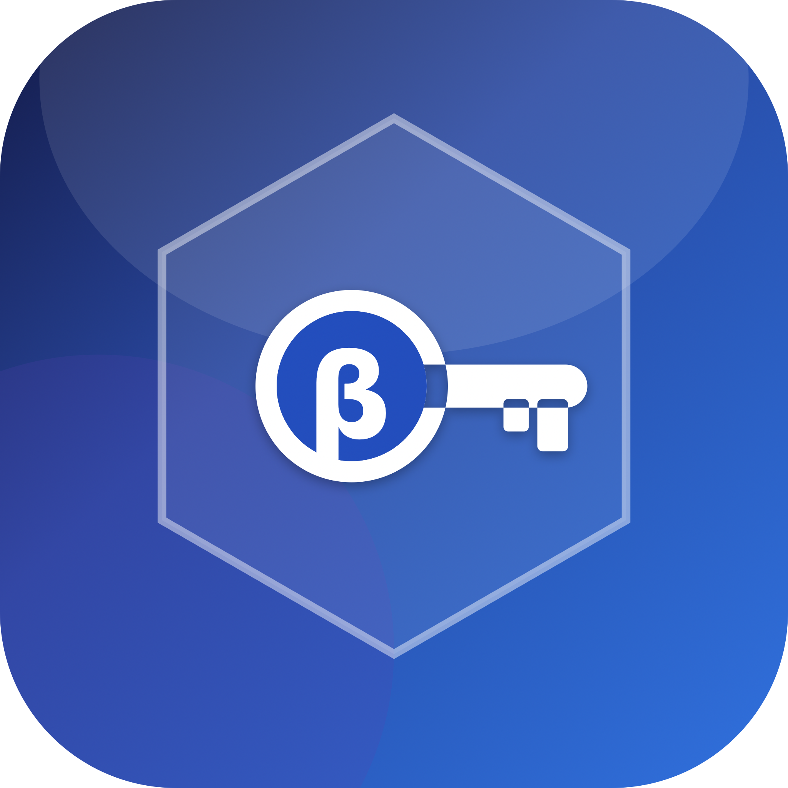

<p align="center">
  
</p>

# Omnissa Beta Token Utility

Get AppleSeed for IT beta enrollment tokens and deliver them with a Workspace
ONE UEM declarative **Software Update: Settings** profile so supervised Apple
devices can enroll in a beta program.

| Deliverable | Role |
|---|---|
| **macOS app** (SwiftUI) | Click-through workflow (recommended for admins) |
| **Rust CLI** (`omnissa-beta-tokens`) | Scripting / automation |
| **Offline guide** (`omnissa-beta-guide.html`) | Full walkthrough with screenshots |

Version is always read from [`rust/Cargo.toml`](rust/Cargo.toml).

> **Pre-release (0.1.0).** Ad-hoc signed only (Gatekeeper warning on first
> launch). Live Apple Business token fetch is proven; keep validating on-device
> enrollment for your tenant. Full detail: [docs/guide.md](docs/guide.md).

## Install locally

```bash
tools/release.sh          # CLI + guide + .app zip + .pkg → dist/release/
# or app / pkg only:
tools/make_app.sh
tools/make_pkg.sh         # → dist/release/Omnissa-Beta-Token-Utility-*-macos.pkg
open "dist/Omnissa Beta Token Utility.app"
# Installer (local test; unsigned pkg may need right-click → Open):
open dist/release/Omnissa-Beta-Token-Utility-0.1.0-macos.pkg
# if Gatekeeper blocks the .app:
xattr -dr com.apple.quarantine "dist/Omnissa Beta Token Utility.app"
```

CLI: `dist/release/omnissa-beta-tokens-0.1.0-macos-arm64`  
Guide: `dist/release/omnissa-beta-guide-0.1.0.html`  
Pkg: `dist/release/Omnissa-Beta-Token-Utility-0.1.0-macos.pkg` → `/Applications`

## How it works

1. **Create a certificate** in the app (or `omnissa-beta-tokens init`).
2. **Apple Business → Devices → Management Services → Add.** Upload the `.pem`,
   download the `.p7m`. Service name: `Workspace One Beta Token Service`
   (copied for you). **Open Apple Business** slides this app left and opens the
   Add page (no Accessibility permission required).
3. **Import the `.p7m`** with **Watch Downloads** (app) or `fetch --watch` (CLI)
   — status shows **Server token ready**.
4. **Fetch programs**, filter by OS, **Copy title** / **Copy token**.
5. **UEM:** **one AppleSeed beta → one token, one profile, one assignment.**
   Use **How to create the UEM profile** (⇧⌘/) for screenshot steps. Beta On →
   Description = title, Token = token → set Program enrollment / Require /
   Offer → assign → publish.
6. **Clean up** when done: delete the ABM service; app teardown or
   `omnissa-beta-tokens cleanup --yes`.

### What success looks like

| Stage | Success |
|---|---|
| Certificate | **Certificate ready**; drag the `.pem` chip into Apple Business |
| Apple Business | Service created; **Download Service Token** works. Device count on **this** service stays **0** (expected — see below) |
| `.p7m` | **Server token ready** checkmark |
| Fetch | **Loaded N beta programs**; pick **one** program |
| UEM | Separate profile **Installed** for that program |
| Device | Software Update shows the expected beta |

### One AppleSeed beta → one token, one profile, one assignment

Each program needs its own enrollment token, declarative Software Update:
Settings profile, and Smart Group assignment — across platforms (macOS vs iOS)
and within a platform (two different macOS seeds). Do not reuse one profile for
multiple programs. Modes (Automatic / Offer / Block) are set **in UEM**, not as
JSON from this tool. See the [mode table](docs/guide.md#modes-uem-fields-only--no-json-from-this-tool).

### Apple Business shows 0 devices — expected

The external management service is **only** for downloading a server token and
calling Apple’s beta API. It is **not** your MDM. Workspace ONE remains the
enrollment server. Do **not** reassign devices to this service.

## Apple documentation

This tool retrieves tokens the same way MDM solutions do, then you paste them
into UEM’s declarative Software Update: Settings > Beta payload:

| Topic | Apple doc |
|---|---|
| End-to-end beta enrollment | [Enrolling a device in a beta program](https://developer.apple.com/documentation/devicemanagement/enrolling-a-device-in-a-beta-program) |
| Token API (`mdmenrollment.apple.com`) | [Get beta enrollment tokens](https://developer.apple.com/documentation/devicemanagement/get-beta-enrollment-tokens) |
| Declarative software updates + Beta | [Deploying software updates using declarative management](https://developer.apple.com/documentation/devicemanagement/deploying-software-updates-using-declarative-management) |
| Software Update overview | [SoftwareUpdate](https://developer.apple.com/documentation/devicemanagement/softwareupdate) |
| AppleSeed for IT (org enrollment) | [beta.apple.com/for-it](https://beta.apple.com/for-it) |
| WWDC24 context | [What’s new in device management](https://developer.apple.com/videos/play/wwdc2024/10143/) |

In the app: **Help → Apple Developer Documentation** opens the enrollment page;
the UEM guidance sheet also links these docs.

## Quick start (CLI)

```bash
omnissa-beta-tokens init
omnissa-beta-tokens fetch --watch
omnissa-beta-tokens fetch --os macOS --match "27" --uem-block
omnissa-beta-tokens cleanup --yes
```

| Flag | Purpose |
|---|---|
| `fetch --watch` | Wait for a new `.p7m` in `~/Downloads`, copy into workdir |
| `fetch --os` / `--match` | Narrow programs |
| `fetch --uem-block` | Title + token + short “create profile” steps (one match only) |
| `cleanup --yes` | Delete local key/cert/`*.p7m` |

Default workdir: `~/.omnissa-beta-tokens` (folder mode 700, key mode 600). The
private key lives beside the cert for openssl decrypt, but is **Finder-hidden**;
the app’s **Show in Finder** opens a temp folder with only the `.pem`.

## App tips

- **View → Make Text Larger / Smaller** (⌘+ / ⌘−) — also follows Dynamic Type.
- **Help → How to Create the UEM Profile** (⇧⌘/) — screenshot walkthrough.
- Drag the `.pem` chip onto Apple Business **Upload Certificate**.

## Security

- OAuth secrets never printed (`[REDACTED]`).
- Decrypted server token stays in memory only.
- Workdir `~/.omnissa-beta-tokens` is mode **700**; key / `.p7m` are mode **600**,
  Finder-hidden, and **excluded from Time Machine**.
- **Show in Finder** stages only the public `.pem` (private key never shown).
- Copied enrollment tokens are cleared from the pasteboard after **60 seconds**.
- Revealed tokens are concealed when the app resigns active (screen share / switch).
- Treat `.p7m` / private key as credentials; never commit them.
- Talks only to `mdmenrollment.apple.com`.
- Still outstanding for stronger shipping security: **Developer ID + notarization**,
  optional Keychain storage for the private key (larger change).

## Known gaps / next improvements

- On-device Software Update UX still worth validating per tenant/build.
- Notarization / Developer ID not done yet (Gatekeeper).
- Bundle offline HTML guide in Help; remember OS filter; cancelable fetch;
  optional UEM console URL; VoiceOver pass; Sparkle once releases exist.
- Repo and releases are private; brand/icon review still open.

## Build from source

```bash
cd rust && cargo test && cargo build --release
tools/make_app.sh
tools/release.sh
```

Release notes: [docs/RELEASING.md](docs/RELEASING.md).  
Admin walkthrough: [docs/guide.md](docs/guide.md) → offline HTML via `build-guide`.

## Branding

Outfit Light/Medium ([SIL OFL 1.1](assets/fonts/OFL.txt)).  
[Brand sheet](docs/branding/brand-template.html) · [Icon variants](docs/branding/logo-d-beta.html)

## License

MIT ([LICENSE](LICENSE)). Improved from `betaTokens.sh` in
[microsoft/shell-intune-samples](https://github.com/microsoft/shell-intune-samples)
(MIT); see [NOTICE](NOTICE).

Apple, Apple Business, and macOS are trademarks of Apple Inc. Workspace ONE and
Omnissa are trademarks of Omnissa. Not affiliated with or endorsed by Apple.
