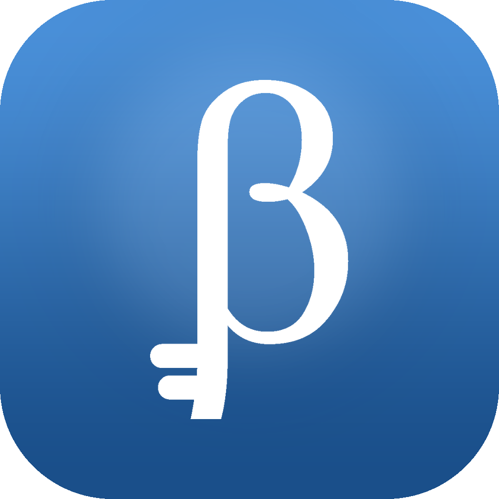

<p align="center">
  
</p>

# Omnissa Beta Token Utility

macOS app for Omnissa / Workspace ONE UEM admins: fetch AppleSeed for IT enrollment tokens and paste them into a declarative **Software Update: Settings → Beta** profile.

**v1.0.0** · [SemVer](https://semver.org/) · Developer ID signed & notarized

## Install

Same version everywhere: Homebrew cask, npm, and the GitHub `.pkg` / `.zip` release.

### Homebrew

```bash
brew tap judahtait/omnissa-beta-tokens
brew trust judahtait/omnissa-beta-tokens
brew install --cask omnissa-beta-token-utility
```

### npm

```bash
npm install -g omnissa-beta-token-utility@1.0.0
```

Installs the notarized app into `~/Applications` and provides the `omnissa-beta-token-utility` command to open it.  
Package: [npmjs.com/package/omnissa-beta-token-utility](https://www.npmjs.com/package/omnissa-beta-token-utility)

### Installer package

```bash
gh release download v1.0.0 -R judahtait/omnissa-beta-tokens \
  -p 'Omnissa-Beta-Token-Utility-*-macos.pkg'
sudo installer -pkg Omnissa-Beta-Token-Utility-1.0.0-macos.pkg -target /
```

## How to use

1. **Create certificate** — upload the `.pem` in Apple Business (private key stays on this Mac).
2. **Add service** — name it `Workspace One AppleSeed Beta Token Service`, upload `.pem`, download the `.p7m`.
3. **Watch Downloads** → **Fetch beta tokens** → **Copy title** / **Copy token**.
4. Create a UEM declarative Beta profile (in-app **How to create the UEM profile**, or [docs/guide.md](docs/guide.md)).
5. Assign → publish → confirm on the device (Settings → Beta Updates).
6. Tear down the ABM service and local credentials when finished.

Apple Business will show **0 devices** on this service — that is expected. Workspace ONE stays the MDM.

ABM service name (copied by the app): **Workspace One AppleSeed Beta Token Service**

Details: [guide](docs/guide.md) · in-app **⇧⌘/**.

## Versioning

Release versions are **Semantic Versioning** (`MAJOR.MINOR.PATCH`), for example `1.0.0`.

| Surface | Where the version lives |
|---|---|
| Source of truth | `rust/Cargo.toml` → `[package] version` |
| npm | `package.json` → `version` (must match) |
| Homebrew cask | `Casks/omnissa-beta-token-utility.rb` → `version` (must match) |
| GitHub release / tag | `v1.0.0` (leading `v` on the tag only) |
| App / pkg / zip / guide filenames | `…-1.0.0-…` (no `v` in the filename) |

Do not use prerelease labels like `0.0.0-stage` for product builds. Bump all three files (`Cargo.toml`, `package.json`, cask) together when cutting a release — see [Releasing](docs/RELEASING.md).

## Docs

- [Admin guide](docs/guide.md) — short walkthrough + screenshots  
- [Wiki source](docs/wiki/Home.md) — same content, split for GitHub Wiki  
- [Releasing](docs/RELEASING.md) — signed / notarized builds  

Apple: [Enrolling a device in a beta program](https://developer.apple.com/documentation/devicemanagement/enrolling-a-device-in-a-beta-program) ·
[Get beta enrollment tokens](https://developer.apple.com/documentation/devicemanagement/get-beta-enrollment-tokens)

## Security

Workdir `~/.omnissa-beta-tokens` (700); key / `.p7m` mode 600, Finder-hidden, Time Machine excluded. Copied tokens clear from the pasteboard after 60s. Releases are Developer ID signed and notarized (Gatekeeper-ready).

## License

MIT. Improved from Microsoft’s `betaTokens.sh` ([NOTICE](NOTICE)).  
Apple and Omnissa / Workspace ONE are trademarks of their respective owners.
