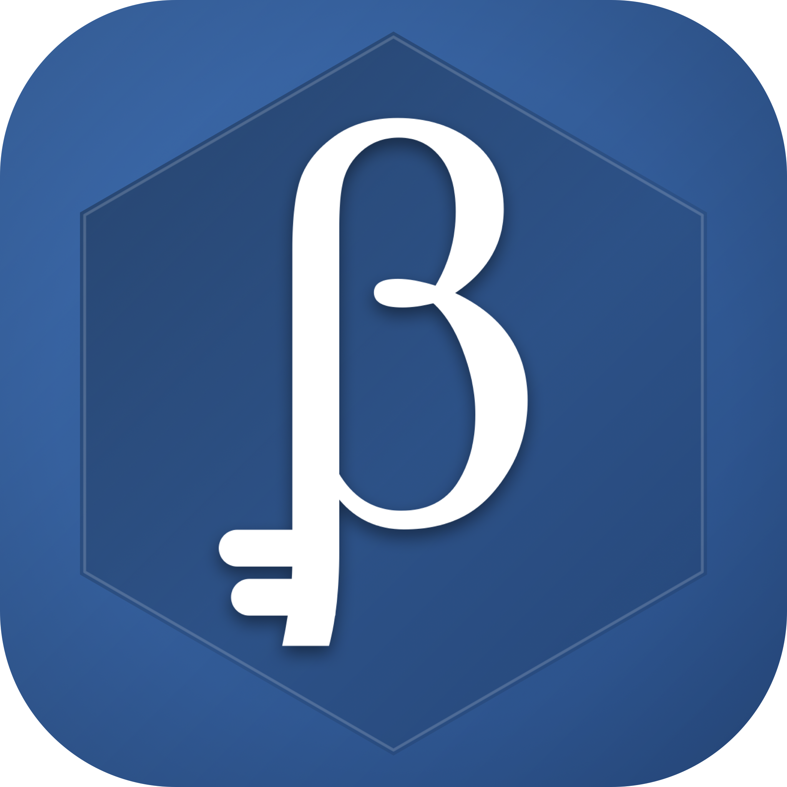

<p align="center">
  
</p>

# Omnissa Beta Token Utility

macOS app for Omnissa / Workspace ONE UEM admins: fetch AppleSeed for IT enrollment tokens and paste them into a declarative **Software Update: Settings → Beta** profile.

Version **0.1.0** — Developer ID signed (`Judah Tait`).

## Install

This repository is **private**. Homebrew cannot use anonymous HTTPS to tap it or download release assets — use SSH and a GitHub token (or install from a clone).

### Homebrew (private tap)

1. Ensure this Mac can reach GitHub over **SSH** (`ssh -T git@github.com`).
2. Create a classic PAT with `repo` scope (or a fine-grained token that can read this repo + its releases), then:

```bash
export HOMEBREW_GITHUB_API_TOKEN="ghp_…"   # needed for private release downloads

brew untap jtait_euc/omnissa-beta-tokens 2>/dev/null || true
brew tap jtait_euc/omnissa-beta-tokens git@github.com:jtait_euc/omnissa-beta-tokens.git
brew install --cask omnissa-beta-token-utility
```

If `brew tap` still fails, clone once and install the cask from disk:

```bash
gh auth login   # or: git clone git@github.com:jtait_euc/omnissa-beta-tokens.git
cd omnissa-beta-tokens
export HOMEBREW_GITHUB_API_TOKEN="ghp_…"
brew install --cask ./Casks/omnissa-beta-token-utility.rb
```

### Installer package (no Homebrew)

```bash
gh release download v0.1.0 -R jtait_euc/omnissa-beta-tokens \
  -p 'Omnissa-Beta-Token-Utility-*-macos.pkg'
sudo installer -pkg Omnissa-Beta-Token-Utility-0.1.0-macos.pkg -target /
```

### Build from a clone

```bash
git clone git@github.com:jtait_euc/omnissa-beta-tokens.git
cd omnissa-beta-tokens
tools/install.sh
```

## How to use

1. **Create certificate** — upload the `.pem` in Apple Business (private key stays on this Mac).
2. **Add service** — name it `Workspace One AppleSeed Beta Token Service`, upload `.pem`, download the `.p7m`.
3. **Watch Downloads** → **Fetch beta tokens** → **Copy title** / **Copy token**.
4. Create a UEM declarative Beta profile (in-app **How to create the UEM profile**, or [docs/guide.md](docs/guide.md)).
5. Assign → publish → confirm on the device (Settings → Beta Updates).
6. Tear down the ABM service and local credentials when finished.

Apple Business will show **0 devices** on this service — that is expected. Workspace ONE stays the MDM.

ABM service name (copied by the app): **Workspace One AppleSeed Beta Token Service**

### Modes (Apple)

| Mode | UEM | Programs per profile |
|---|---|---|
| Automatic | AlwaysOn + Require | One |
| Offer to user | Allowed + Offer | One or more (same OS) |
| Offer, no sign-in | AlwaysOn + Offer | One or more (same OS) |
| Block and unenroll | AlwaysOff | None |

macOS and iOS need **separate** profiles. Details: [guide](docs/guide.md) · in-app **⇧⌘/**.

## Docs

- [Admin guide](docs/guide.md) — short walkthrough + screenshots  
- [Wiki source](docs/wiki/Home.md) — same content, split for GitHub Wiki  
- [Releasing](docs/RELEASING.md) — engineers building signed/notarized builds  

Apple: [Enrolling a device in a beta program](https://developer.apple.com/documentation/devicemanagement/enrolling-a-device-in-a-beta-program) ·
[Get beta enrollment tokens](https://developer.apple.com/documentation/devicemanagement/get-beta-enrollment-tokens)

## Security

Workdir `~/.omnissa-beta-tokens` (700); key / `.p7m` mode 600, Finder-hidden, Time Machine excluded. Copied tokens clear from the pasteboard after 60s. Builds are Developer ID signed; notarization is the remaining Gatekeeper step for downloadable releases.

## License

MIT. Improved from Microsoft’s `betaTokens.sh` ([NOTICE](NOTICE)).  
Apple and Omnissa / Workspace ONE are trademarks of their respective owners.
