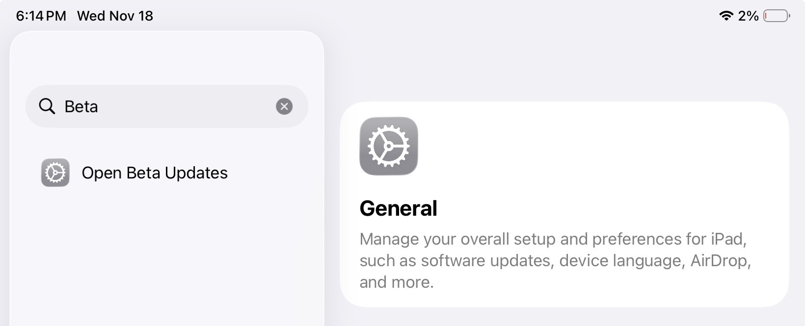
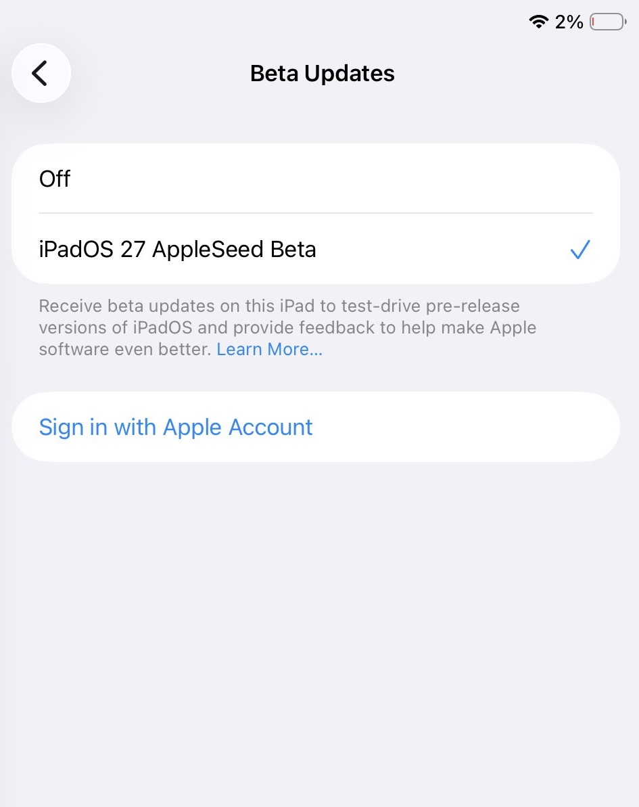

# Enrolling Apple Devices in a Beta Program with Workspace ONE UEM

<!-- Source for the branded HTML guide. Redact tokens, tenant names, and session
data in screenshots before external use. -->

## 1. In one minute

| Step | What you do |
|---|---|
| 1 | Fetch AppleSeed **enrollment tokens** with Omnissa Beta Token Utility |
| 2 | Put them in a Workspace ONE UEM **declarative** Software Update: Settings → **Beta** profile |
| 3 | Assign to a pilot group, publish, confirm on the device |

This matches Apple’s model and how other MDMs (Jamf Blueprints, Fleet DDM, Intune token scripts) deliver the same tokens.

## 2. Before you start

- Apple Business (or School Manager) admin  
- Org enrolled in [AppleSeed for IT](https://beta.apple.com/for-it)  
- UEM with declarative management  
- **macOS 15.4+** or **iOS / iPadOS 18+**, supervised for Automatic / Block  
  (Offer works on unsupervised; user enrolls manually)  
- tvOS / visionOS: Beta setting not supported  

<!-- UTILITY_DOWNLOAD -->

## 3. Get tokens

1. **Create certificate** in the app — drag the `.pem` into Apple Business (private key stays hidden).
2. **Open Apple Business** → add service `Workspace One AppleSeed Beta Token Service` → upload `.pem` → **Download Service Token** (`.p7m`).

   

3. **Watch Downloads** → **Fetch beta tokens** → filter by OS → **Copy title** / **Copy token**.

> **0 devices on this Apple Business service is expected.** It only unlocks the beta API. Workspace ONE remains the MDM — do not reassign devices here.

## 4. Choose a mode (then build the profile)

### What Apple allows

| Mode | Program enrollment | Require | Offer | When to use |
|---|---|---|---|---|
| **Automatic** | AlwaysOn | **One** program | Off | Force a specific beta |
| **Offer to user** | Allowed | Off | **One or more** programs | User may also use Apple Account |
| **Offer, no sign-in** | AlwaysOn | Off | **One or more** programs | User picks from your list only |
| **Block and unenroll** | AlwaysOff | Off | Off | Leave / block betas |

- **Require program** = single Description + Token (forced enrollment).  
- **Offer programs** = Apple’s array — **multiple** Description + Token pairs in **one** declaration are allowed, **same OS only**.  
- Never combine Allowed + Require.  
- Always separate **macOS** and **iOS** profiles (UEM is platform-scoped).

### Build it in UEM

1. **Resources → Profiles → Add → Add Profile** → Apple platform matching the token.

   
   

2. **Declarative** · **Configuration** · **Device** → Next.

   

3. Add **Software Update: Settings** → Beta On.  
   - Automatic: paste title → Description, token → Token.  
   - Offer: add a Description + Token row for each same-OS program.  
4. Assign a small supervised pilot Smart Group → publish.

   

In-app screenshots: **How to create the UEM profile** (⇧⌘/).

## 5. Confirm and clean up

**Confirm in UEM:** profile shows **Installed** on the device.

**Confirm on the device:** Settings → search **Beta** → **Beta Updates** (or Software Update → Beta Updates). The AppleSeed program from your profile should appear; with Offer modes the user can select it.

*iPad example: **iPadOS 27 AppleSeed Beta** is selected under Beta Updates. Mac path: System Settings → General → Software Update.*

**Leave a beta:** assign **Block and unenroll**, then remove the enroll profile from that group.

**Clean up tokens service:** delete the Apple Business management service → app teardown or `omnissa-beta-tokens cleanup --yes`.

## 6. Troubleshooting

| Symptom | Fix |
|---|---|
| 403 `APPLE_SEED_FOR_IT_TURNED_OFF` | Enroll at beta.apple.com/for-it |
| Session 401/403 | New ABM service + fresh `.p7m` |
| Decrypt failed | Re-create cert, re-upload matching `.pem` |
| Device not enrolling | Mode valid? Supervised? OS floor? Platform match? |
| 0 devices in Apple Business | Expected — see §3 |
| Gatekeeper on download | Complete notarization, or right-click → Open until stapled |

## 7. References

- [Enrolling a device in a beta program](https://developer.apple.com/documentation/devicemanagement/enrolling-a-device-in-a-beta-program)  
- [Get beta enrollment tokens](https://developer.apple.com/documentation/devicemanagement/get-beta-enrollment-tokens)  
- [Software Update settings (declarative)](https://support.apple.com/guide/deployment/software-update-settings-declarative-dep0578d8b8a/web)  
- [AppleSeed for IT](https://beta.apple.com/for-it)  
- [README](../README.md) · [Wiki](wiki/Home.md)
