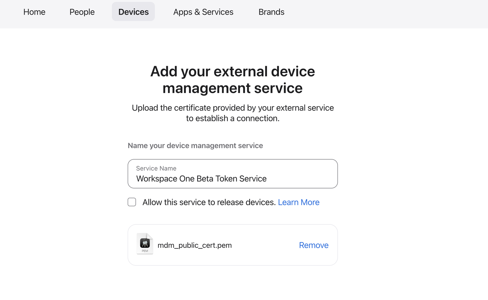

# Enrolling Apple Devices in a Beta Program with Workspace ONE UEM
**Status:** Draft only. Review required by Legal, Compliance, or relevant Omnissa control owner.
**Date:** 2026-11-17
**Author:** Judah Tait (Support Engineering)

---

<!-- Source for the branded HTML guide (python3 tools/build_guide.py).
Screenshots are placeholders and must be cropped/redacted (no tokens or tenant
secrets) before use. -->

## 1. Overview

Apple lets organizations enroll managed devices in beta programs (AppleSeed for
IT) using organization-specific beta enrollment tokens. Workspace ONE UEM
delivers the token to devices with a declarative **Software Update: Settings**
configuration (Beta dictionary).

Flow: get tokens from Apple Business -> create a UEM declarative profile ->
assign to devices -> verify on the device.

## 2. Prerequisites

- Apple Business (or Apple School Manager) administrator access.
- The organization enrolled in AppleSeed for IT: https://beta.apple.com/for-it
  (otherwise Apple returns 403 `APPLE_SEED_FOR_IT_TURNED_OFF`).
- Workspace ONE UEM with declarative management support for the target OS.
- A Mac or Linux machine with Python 3.9+ and `openssl` (to run the utility).
- Supervised devices for UEM-controlled enrollment/unenrollment. On
  unsupervised devices only offering a program is possible (user enrolls
  manually). Source: Apple "Enrolling a device in a beta program".

## 3. Download the utility

`omnissa-beta-tokens` is a single Python file with no third-party dependencies.
Download it below, verify the hash, and run it with `python3`. You can read the
full source before running it.

<!-- UTILITY_DOWNLOAD -->

Run it like this (macOS or Linux):

```
python3 omnissa-beta-tokens.py --help
```

## 4. Get the beta tokens

### 4.1 Create the certificate

Run `python3 omnissa-beta-tokens.py init`. It creates a private key and a
certificate (`.pem`) in `~/.omnissa-beta-tokens`. The utility prints the exact
path of the `.pem` to upload.

### 4.2 Open Management Services in Apple Business

Go straight to the Add page:
https://business.apple.com/main/devices/managementservices/mdmservers/add

Or navigate there: sign in to Apple Business, choose **Devices** in the top
bar, select **Management Services** in the left menu, and next to
**Device Management Services** select **Add**.


*Figure 1. Devices > Management Services. Select **Add** (right side of the
Device Management Services row).*

### 4.3 Add the external device management service

1. Enter the service name `Workspace One Beta Token Service`. Apple's form
   cannot be prefilled, so the utility copies this name to your clipboard when
   you run `init` or select **Open Apple Business** in the app. Paste it into
   **Service Name**.
2. Leave **Allow this service to release devices** unchecked.
3. Select **Upload Certificate** and choose the `.pem` file from step 4.1
   (`~/.omnissa-beta-tokens/mdm_public_cert.pem`).
4. Continue (Step 2 of 2), then select **Download Service Token** to get the
   `.p7m`. Service tokens can be redownloaded.


*Figure 2. Add your external device management service. Name it, leave the
release checkbox cleared, and upload the `.pem`.*



*Figure 3. The completed form, ready to continue.*

### 4.4 Get the beta programs

1. Run `python3 omnissa-beta-tokens.py fetch --watch` (or `--p7m <file>`).
2. Pick the program you need, for example `macOS 27 Golden Gate AppleSeed Beta`.
   Use `--reveal` or `--format json` to get the full token.

If you use the Omnissa Beta Token Utility app, the same steps are on screen:
**Open Apple Business** takes you to the Add page, then choose the `.p7m`.

Security: the `.p7m`, key and tokens are credentials. Do not share or commit
them. When finished, delete the management service in Apple Business.

## 5. Create the Workspace ONE UEM profile

1. In UEM: **Resources > Profiles & Baselines > Profiles > Add > Add Profile**.
2. Choose the platform (iOS, macOS, tvOS or visionOS).
3. Set **Management Type** = Declarative, **Declaration Type** = Configuration,
   **Context** = Device. Select Next.
4. Name the profile (for example `macOS 27 Golden Gate AppleSeed Beta`).
5. Add the **Software Update: Settings** payload and turn on **Beta**
   (requires macOS 15.4 per the console).
6. Set **Program enrollment** (Allowed, AlwaysOn or AlwaysOff).
7. Turn on **Require program** and enter:
   - Description: the program title.
   - Token: the token for the matching OS and program.
8. Select Next, set the assignment, then save and publish.

[Screenshot placeholders: Add Profile platform picker; Declaration type;
Software Update:Settings Beta - token field MUST be redacted]

### Program enrollment values (from Apple)

| Value | Behavior |
|---|---|
| Allowed | User may enroll in programs their Apple Account has, plus `OfferPrograms`. |
| AlwaysOn | No sign-in needed; all `OfferPrograms` offered. Use with `RequireProgram` to enroll automatically. |
| AlwaysOff | Prevents enrollment and unenrolls the device from any beta program. |

Note: the tested tenant configuration used Allowed with Require program enabled.
Apple's documentation pairs `RequireProgram` with `AlwaysOn`. Confirm which
combination gives the expected result on your target OS before publishing this
guide. Behavior difference: data unavailable.

## 6. Verify on the device

- Confirm the profile shows as installed/compliant in UEM (Devices > device >
  Profiles).
- On the device, open Software Update and confirm the beta program is offered.
- Exact on-device verification steps per OS: data unavailable (to be validated).

## 7. Unenroll

Assign a profile with Program enrollment = AlwaysOff to the device. This
removes the device from any beta program. Supervised devices only.

## 8. Troubleshooting

| Symptom | Cause | Action |
|---|---|---|
| 403 `APPLE_SEED_FOR_IT_TURNED_OFF` | Org not enrolled in AppleSeed for IT | Enroll at beta.apple.com/for-it |
| Session request fails (401/403) | Server token expired or revoked | Create a new management service and `.p7m` |
| Token not accepted | Token expired for its seeding period | Fetch fresh tokens |
| Decrypt failed | `.p7m` does not match uploaded `.pem` | Re-run `init` and re-upload |
| Device not enrolling | Unsupervised device | Offer the program; user enrolls manually |

## 9. References

- Apple: Enrolling a device in a beta program -
  https://developer.apple.com/documentation/devicemanagement/enrolling-a-device-in-a-beta-program
- Apple: Get beta enrollment tokens -
  https://developer.apple.com/documentation/devicemanagement/get-beta-enrollment-tokens
