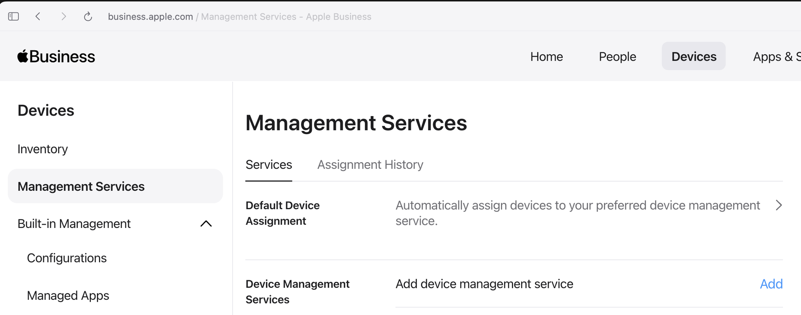
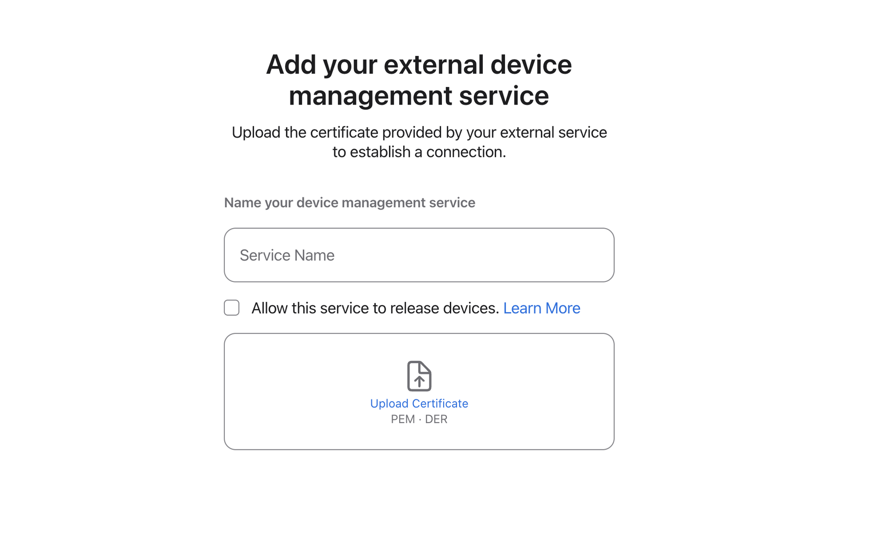
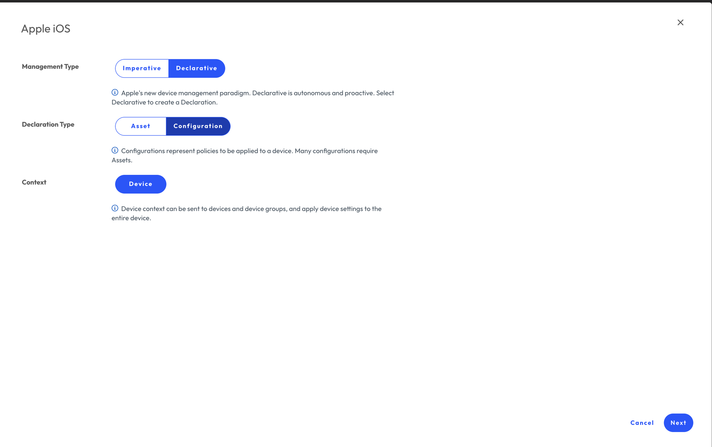
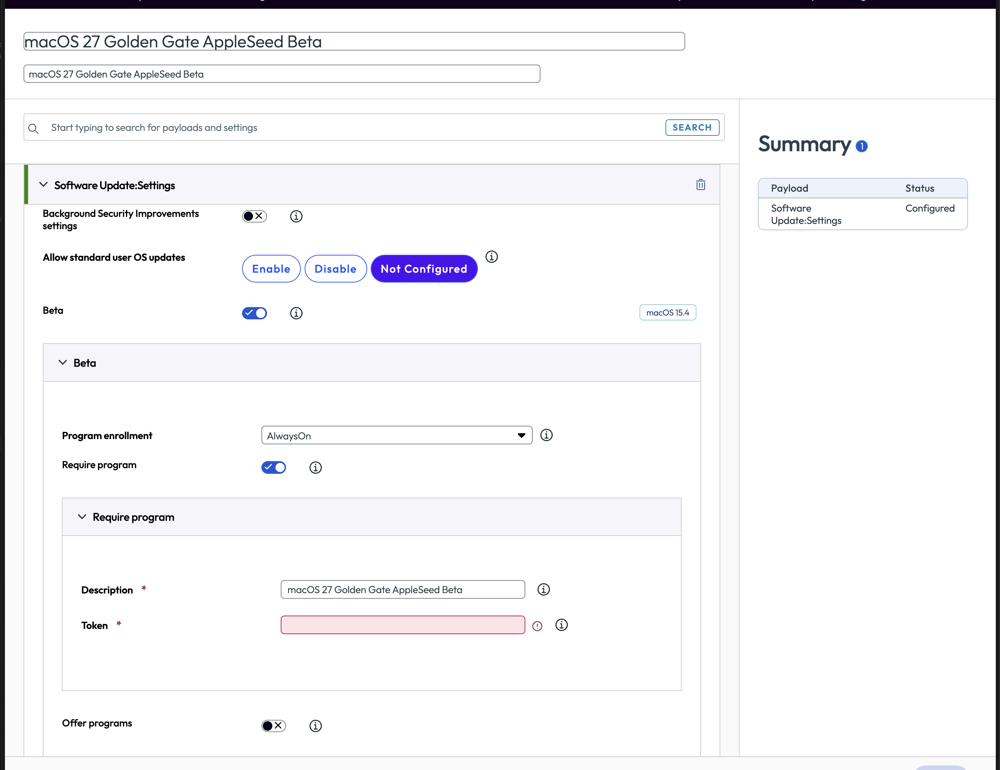

# Enrolling Apple Devices in a Beta Program with Workspace ONE UEM
**Status:** Draft only. Review required by Legal, Compliance, or relevant Omnissa control owner.
**Date:** 2026-11-18
**Author:** Judah Tait (Support Engineering)

---

<!-- Source for the branded HTML guide.
Screenshots must be cropped and redacted (no tokens, tenant names, or session
data) before external use. -->

## 1. Overview

Apple lets organizations enroll managed devices in beta programs (AppleSeed for
IT) using organization-specific beta enrollment tokens. Workspace ONE UEM
delivers the token with a declarative **Software Update: Settings**
configuration (the Beta dictionary).

High-level flow:

1. Create a local key and certificate with Omnissa Beta Token Utility.
2. Register an external device management service in Apple Business and download
   the `.p7m` server token.
3. Fetch the organization's beta programs and copy a token (optionally via
   `--uem-block`).
4. Build a Workspace ONE UEM declarative profile, assign it, and publish.
5. Confirm enrollment on the device (see [On-device validation checklist](#6-on-device-validation-checklist) and [Known gaps](#12-known-gaps)).
6. When finished, delete the Apple Business service and clean up local files
   (see [Finish / cleanup](#9-finish--cleanup)).

## 2. Prerequisites

- Apple Business (or Apple School Manager) administrator access.
- Organization enrolled in [AppleSeed for IT](https://beta.apple.com/for-it)
  (otherwise Apple returns 403 `APPLE_SEED_FOR_IT_TURNED_OFF`).
- Workspace ONE UEM with declarative management for the target OS.
- Supervised devices for UEM-controlled enrollment and unenrollment. On
  unsupervised devices, only offering a program is possible (the user enrolls
  manually). Source: Apple *Enrolling a device in a beta program*.
- A Mac to run the app or CLI (see [Download](#3-download)).

## 3. Download

| Format | Best for | Needs |
|---|---|---|
| **macOS app** (SwiftUI `.app`) | Click-through workflow | macOS 13 or later |
| **Rust CLI** (`omnissa-beta-tokens`, macos-arm64) | Scripting | Apple Silicon Mac |

Local build (recommended while iterating):

```
tools/make_app.sh
open "dist/Omnissa Beta Token Utility.app"
```

Or `tools/release.sh` for CLI + guide + app under `dist/release/`. Version comes
from `rust/Cargo.toml`. Until builds are notarized: right-click → **Open**, or
`xattr -dr com.apple.quarantine "dist/Omnissa Beta Token Utility.app"`.

<!-- UTILITY_DOWNLOAD -->

CLI examples use `omnissa-beta-tokens`. The app is the SwiftUI shell for the same
admin workflow (Watch Downloads, Copy title/token, UEM next steps).

```
omnissa-beta-tokens --help
```

## 4. Get the beta tokens

### 4.1 Create the certificate

```
omnissa-beta-tokens init
```

This creates a private key and a certificate (`.pem`) in
`~/.omnissa-beta-tokens` (mode 700 for the folder, 600 for the key). The tool
prints the `.pem` path to upload. In the app, choose **Create certificate**.

Treat the private key and later the `.p7m` as credentials. Do not commit or
share them. When you are finished, delete the management service in Apple
Business and run `omnissa-beta-tokens cleanup --yes` (see
[Finish / cleanup](#9-finish--cleanup)).

### 4.2 Open Management Services in Apple Business

Go straight to the Add page:
https://business.apple.com/main/devices/managementservices/mdmservers/add

Or navigate: sign in to Apple Business → **Devices** → **Management Services**
→ **Add** next to **Device Management Services**.



*Figure 1. Devices > Management Services. Select **Add** (right side of the
Device Management Services row).*

### 4.3 Add the external device management service

1. Enter the service name `Workspace One Beta Token Service`. Apple's form
   cannot be prefilled, so `init` and the app's **Open Apple Business** action
   copy this name to the clipboard and open a split view (app left, default
   browser right). Paste the name into **Service Name**. If macOS asks to allow
   control of that browser (or Accessibility), choose **Allow** once — that is
   how the browser window is tiled. You should not see “Where is …?” pickers.
2. Leave **Allow this service to release devices** unchecked.
3. Select **Upload Certificate** and choose the `.pem` from step 4.1
   (`~/.omnissa-beta-tokens/mdm_public_cert.pem`).
4. Continue (Step 2 of 2), then select **Download Service Token** to get the
   `.p7m`. Prefer the app’s **Watch Downloads** (or CLI `fetch --watch`) so the
   new file is imported automatically — do not keep a stale `.p7m` selected.
   Service tokens can be redownloaded later if needed.


*Figure 2a. Download Service Token — then let the app pick up the new `.p7m`.*



*Figure 2. Add your external device management service. Name it, leave the
release checkbox cleared, and upload the `.pem`.*


*Figure 3. The completed form, ready to continue.*

> **Apple Business will show 0 devices on this management service — that is
> expected.** This service exists only so you can download a server token and
> call Apple’s beta enrollment API. It is **not** the MDM that your Macs and
> iPhones enroll with. Workspace ONE (or your existing MDM) remains the
> enrollment server. Apple’s Management Services list can still show a
> **Devices** count of **0** for this entry even when hundreds of devices are
> managed in UEM. Do not treat that zero as a failure or as a reason to reassign
> devices to this service.

### 4.4 What success looks like

| Stage | You should see |
|---|---|
| Certificate | App: **Certificate ready**; `mdm_public_cert.pem` in `~/.omnissa-beta-tokens` (or drag the chip into Apple Business). |
| Apple Business service | Service created; you can **Download Service Token**. Device count for **this** service stays **0** (see callout above). |
| `.p7m` import | App: **Watch Downloads** finishes with “Imported …p7m”; or CLI `fetch --watch` copies the new file. |
| Fetch tokens | App/CLI: **Loaded N beta programs** (often ~20); filter by OS and pick one program. |
| UEM profile | One declarative **Software Update: Settings** profile **per platform**; Beta On; Description = program title; Token = token; assigned and published. |
| Device | In UEM: profile **Installed**. On the device: Software Update shows the expected beta (or Automatic enrollment completed). **Not** in Apple Business under this token service’s device list. |

### 4.5 Fetch the beta programs

```
omnissa-beta-tokens fetch --watch   # waits for a new .p7m in ~/Downloads, copies it in
# App: Step 2 → Watch Downloads (same behavior)
# or: omnissa-beta-tokens fetch --p7m ~/Downloads/something.p7m
```

Useful filters and outputs:

```
omnissa-beta-tokens fetch --os macOS --reveal
omnissa-beta-tokens fetch --match "macOS 27" --format json
omnissa-beta-tokens fetch --os macOS --match "27" --uem-block
```

`--uem-block` requires **exactly one** matched program (narrow with `--os`
and/or `--match`). It prints Title, Token, and a Mode field checklist for the
UEM console — **not** declaration JSON — and copies the block to the clipboard
when `pbcopy` is available.

In the macOS app: use **Watch Downloads** (or choose the `.p7m`), then **Fetch
beta tokens**, pick a program, **Copy title** / **Copy token**, and create the
UEM profile for that platform (**Copy UEM next steps** pastes the short
checklist).

Security notes:

- OAuth secrets are never printed in full; they appear as `[REDACTED]`.
- The decrypted server token stays in memory only.
- Table output masks beta tokens unless you pass `--reveal` (or use Reveal in
  the app). JSON and CSV output include full tokens because they are for export.
- If `access_token_expiry` on the server token is in the past, the CLI warns you
  to regenerate the `.p7m` in Apple Business.
- If any matched program is tvOS or visionOS, the CLI warns that UEM Software
  Update: Settings > Beta cannot deliver those platforms.

## 5. Create the Workspace ONE UEM profile

### 5.1 Supported devices

The Beta setting is part of the declarative **Software Update: Settings**
configuration. Source: Apple's `softwareupdate.settings` declaration schema.

| Platform | Beta setting | Requirement |
|---|---|---|
| macOS | Supported | macOS 15.4 or later, **supervised** |
| iOS and iPadOS | Supported | Supervised. Version follows the Software Update Settings payload (iOS 18.0 or later per the schema). |
| tvOS, visionOS | Not supported | The schema lists the Beta key as not applicable. The app/CLI may still list tokens for these programs; they cannot be delivered with this setting. |

On unsupervised devices only **Offer programs** can be used (the user enrolls
manually). The organization must also be enrolled in AppleSeed for IT.

### 5.2 Separate declarations per platform (required)

Apple’s Software Update: Settings **Beta** payload is **platform-scoped** in
UEM: you pick **Apple macOS** or **Apple iOS** (or iPadOS) when creating the
profile. A macOS beta token cannot ride inside an iOS declaration, and the
reverse is also true.

**Rule:** create **one declarative Software Update: Settings profile per
platform (and usually per program)** you intend to assign.

| Platform filter in the app/CLI | UEM Add Profile platform | Example profile name |
|---|---|---|
| macOS | Apple **macOS** | `macOS 27 Golden Gate AppleSeed Beta` |
| iOS | Apple **iOS** | `iOS 27 AppleSeed Beta` |
| iPadOS (if listed separately) | Apple **iOS** / iPadOS as your tenant labels it | `iPadOS 27 AppleSeed Beta` |
| tvOS / visionOS | — | **Do not** create a Beta declaration; UEM cannot deliver these |

Workflow:

1. In the app/CLI, filter **OS** to one platform (for example macOS).
2. Select that platform’s program → **Copy title** into UEM **Description**,
   **Copy token** into UEM **Token** (or use **Copy for UEM** as a reference
   block — paste only title and token into those two fields, **not** the mode
   checklist into Description).
3. Repeat with a **new** UEM profile for the next platform (new Add Profile →
   choose that platform again).
4. Assign each profile to Smart Groups that match that platform only.

### 5.3 Create the profile

1. In UEM: **Resources > Profiles & Baselines > Profiles > Add > Add Profile**.

   

   *Figure 4. Choose the platform — this choice must match the token’s OS.*

2. Set **Management Type** = Declarative, **Declaration Type** = Configuration,
   **Context** = Device. Select Next.

   

   *Figure 5. Declarative, Configuration, Device.*

3. Name the profile for **that platform and program** (for example
   `macOS 27 Golden Gate AppleSeed Beta`).
4. Add the **Software Update: Settings** payload and turn on **Beta**.
5. Choose a mode from the table below. Enter **only** the program **title** in
   **Description** and the **token** in **Token** (see [5.2](#52-separate-declarations-per-platform-required)).
6. Select Next, set the assignment (see [Assignment checklist](#55-assignment-checklist)), then save and publish.



*Figure 6. Paste Description = program title, Token = enrollment token. Mode
fields must match the table below (Automatic = AlwaysOn + Require on, Offer off).*

### 5.4 Choose a mode (UEM field guidance only)

Apple's schema only allows these combinations. Enter them in the UEM Beta
payload (`fetch --uem-block` and the app’s UEM next-steps copy show the matching
field summary). **Do not expect declaration JSON from this tool** — paste title
and token, then set the fields.

| Mode | Program enrollment | Require program | Offer programs | Result |
|---|---|---|---|---|
| Automatic (`auto`) | AlwaysOn | On | Off | The device enrolls in the program automatically. Users cannot enroll using their own Apple Account. |
| Offer to user (`offer`) | Allowed | Off | On | The user can enroll in programs on their Apple Account, plus the offered program. |
| Offer, no sign-in (`offer-always-on`) | AlwaysOn | Off | On | The offered programs are presented for the user to choose. Users cannot use their own Apple Account. |
| Block and unenroll (`off`) | AlwaysOff | Off | Off | The device cannot enroll, and is removed from any beta program it is in. |

Rules from the schema:

- **Require program** is only valid with Program enrollment = **AlwaysOn**.
- **Offer programs** must not be set together with **Require program**.
- **AlwaysOff** carries no program.

Do **not** use Allowed together with Require program. That combination is
invalid under Apple's schema. Use **Automatic** instead.

### 5.5 Assignment checklist

Use this before publishing the profile:

- [ ] **Supervised only** — exclude unsupervised devices from assignment
      (Automatic / Block and unenroll require supervision).
- [ ] **OS floors** — macOS **15.4+**; iOS / iPadOS **18.0+** (per the Software
      Update Settings schema). Exclude older builds from the Smart Group.
- [ ] **Smart Group tips** — prefer an explicit test Smart Group first (named
      devices or a small pilot). Filter on platform, OS version, and
      supervision/enrollment status your tenant exposes. Avoid “all devices”
      until on-device validation passes.
- [ ] **Separate enroll vs. exit profiles** — one profile for the beta mode you
      want (for example Automatic), and a second profile in **Block and
      unenroll** (AlwaysOff) for teardown. Do not rely on simply removing the
      enroll profile if you need devices out of the beta program.
- [ ] **Assignment exclusivity** — devices should not receive conflicting Beta
      modes at once; assign the Block and unenroll profile when exiting, and
      remove or exclude the enroll profile for those devices.
- [ ] **One profile per platform** — macOS token in a macOS declaration; iOS
      token in an iOS declaration (see [5.2](#52-separate-declarations-per-platform-required)).
- [ ] **Title and token** match `fetch` / Copy title + Copy token (no checklist
      text in Description; no extra whitespace).
- [ ] Publish / activate completed; no draft-only assignment left behind.

## 6. On-device validation checklist

Human E2E scaffold. Items remain unchecked until a supervised test Mac and
iPhone confirm them. Treat section results as assumptions until then.

### Mac (supervised, macOS 15.4+)

- [ ] Profile shows as installed in UEM (**Devices** > device > **Profiles**).
- [ ] Software Update path: **System Settings > General > Software Update**.
- [ ] Expected beta program / build is offered (or Automatic enrollment
      completed without a user Apple Account prompt, if using Automatic).
- [ ] After Block and unenroll assignment: beta offer is gone / device left the
      program.
- [ ] Note UEM status items if visible (`softwareupdate.beta-enrollment`,
      `softwareupdate.pending-version`) — or mark “not surfaced in console”.

### iPhone (supervised, iOS 18+)

- [ ] Profile shows as installed in UEM.
- [ ] Software Update path: **Settings > General > Software Update**.
- [ ] Expected beta program / build is offered (or Automatic enrollment
      behavior matches the chosen mode).
- [ ] After Block and unenroll assignment: device left the program / beta offer
      cleared.
- [ ] Note any user-visible prompts that differ from macOS.

### Cross-checks

- [ ] Token period still valid (re-fetch if the seeding period rolled).
- [ ] Apple Business management service still shows **0 devices** — expected;
      do not move MDM enrollment to this service.
- [ ] Screenshots for the guide (token redacted; no tenant or session data).
- [ ] Record OS builds and UEM console version used for the test.

## 7. Verify on the device (summary)

- In UEM, confirm the profile shows as installed (**Devices** > the device >
  **Profiles**).
- Apple defines status items `softwareupdate.beta-enrollment` and
  `softwareupdate.pending-version`. Whether the UEM console surfaces them:
  data unavailable.
- On the device, open Software Update (iOS and iPadOS: **Settings > General >
  Software Update**; macOS: **System Settings > General > Software Update**)
  and confirm the beta update is offered.

Use the [On-device validation checklist](#6-on-device-validation-checklist) for
the full Mac + iPhone pass. See [Known gaps](#12-known-gaps): on-device menu
paths and enrollment behavior have not been validated end to end yet.

## 8. Unenroll

Assign a profile in **Block and unenroll** mode (Program enrollment =
AlwaysOff) to the device. This removes the device from any beta program.
Supervised devices only. Prefer a dedicated Smart Group / assignment for exit
(see [Assignment checklist](#5-4-assignment-checklist)).

## 9. Finish / cleanup

When you no longer need the Apple Business management service used for token
fetch:

1. Unenroll devices that should leave the beta (section 8), or leave them
   enrolled if that is intentional.
2. In Apple Business, delete the external device management service
   (`Workspace One Beta Token Service` or the name you used).
3. Remove local credentials:

```
omnissa-beta-tokens cleanup --yes
```

`cleanup` deletes `mdm_private.key`, `mdm_public_cert.pem`, and any `*.p7m`
under `--workdir` (default `~/.omnissa-beta-tokens`). It does **not** delete the
Apple Business service — do that in the portal. Without `--yes`, the CLI prompts
on a TTY and refuses on a non-interactive terminal.

## 10. Troubleshooting

| Symptom | Cause | Action |
|---|---|---|
| 403 `APPLE_SEED_FOR_IT_TURNED_OFF` | Org not enrolled in AppleSeed for IT | Enroll at beta.apple.com/for-it |
| Session request fails (401/403) | Server token expired or revoked | Create a new management service and `.p7m` |
| CLI warns about `access_token_expiry` | Server token past expiry | Regenerate `.p7m` in Apple Business |
| Token not accepted | Token expired for its seeding period | Fetch fresh tokens |
| Decrypt failed | `.p7m` does not match uploaded `.pem` | Re-run `init` and re-upload |
| `--uem-block` errors | More than one program matched | Narrow with `--os` and/or `--match` |
| Device not enrolling | Unsupervised device | Offer the program; user enrolls manually |
| Profile does not enroll the device | Invalid combination (for example Allowed with Require program) | Use Automatic: AlwaysOn with Require program |
| Apple Business shows **0 devices** on the beta-token management service | Expected — this service is for API/token access only; MDM enrollment stays on Workspace ONE | Do not reassign devices to this service |
| tvOS or visionOS device not enrolling | Beta setting not supported on these platforms | Not applicable; see the compatibility table |
| macOS blocks the app on first launch | Build not notarized yet | Right-click → Open, or clear quarantine with `xattr` |

## 11. References

- Apple: [Enrolling a device in a beta program](https://developer.apple.com/documentation/devicemanagement/enrolling-a-device-in-a-beta-program)
- Apple: [Get beta enrollment tokens](https://developer.apple.com/documentation/devicemanagement/get-beta-enrollment-tokens)
- Project README (download formats, security model, known gaps)

## 12. Known gaps

- **On-device behavior** (which devices enroll, and what users see in Software
  Update) has not been validated end to end. The checklist in section 6 is the
  scaffold for that work; steps remain assumptions until a supervised test Mac
  or iPhone confirms them.
- **UEM Beta payload screenshot** for Automatic mode is still a placeholder
  above. Capture with the token redacted before external sharing.
- **Signing and notarization** for the macOS app are not done yet; Gatekeeper
  will warn on first launch until Developer ID signing and notarization land.
- **Private distribution** — the repository and releases are private; there is
  no public download channel yet.
- Builds talk only to `mdmenrollment.apple.com` for token fetch. They need no
  other cloud account.
