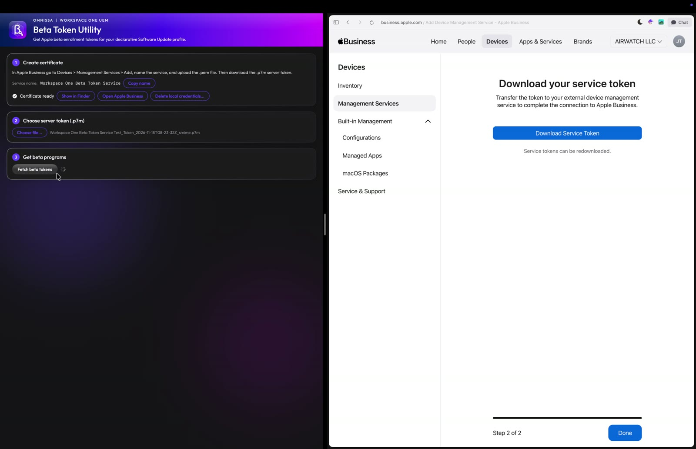
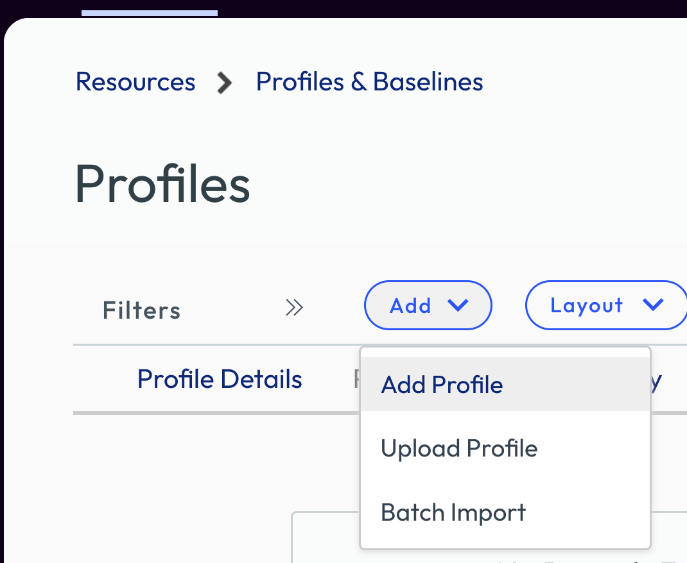
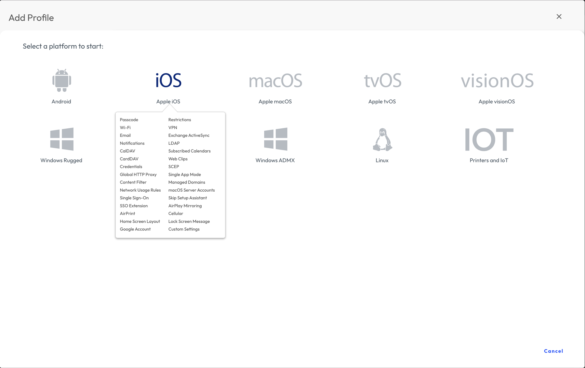

# Enrolling Apple Devices in a Beta Program with Workspace ONE UEM
**Status:** Draft — Legal / Compliance review required.  
**Date:** 2026-11-18 · **Author:** Judah Tait (Support Engineering)

---

<!-- Source for the branded HTML guide. Redact tokens, tenant names, and session
data in screenshots before external use. -->

## 1. What this does

1. Use **Omnissa Beta Token Utility** (app or CLI) to create a cert and fetch
   AppleSeed for IT enrollment tokens from Apple Business.
2. Paste **one** token into a Workspace ONE UEM declarative **Software Update:
   Settings** profile (Beta).
3. Assign, publish, confirm on the device — then clean up when finished.

**Rule:** one AppleSeed beta → one token → one profile → one assignment.
macOS tokens go in macOS profiles; iOS tokens in iOS profiles. Do not reuse one
profile for multiple programs.

## 2. Before you start

- Apple Business (or School Manager) admin
- Org enrolled in [AppleSeed for IT](https://beta.apple.com/for-it)
- UEM with declarative management
- Supervised devices for Automatic / Block modes (Offer works on unsupervised,
  user enrolls manually)
- Supported floors: **macOS 15.4+**, **iOS / iPadOS 18+** (tvOS / visionOS: Beta
  setting not supported)
- A Mac for the app (`tools/make_app.sh` or the `.pkg`) or CLI

<!-- UTILITY_DOWNLOAD -->

## 3. Get a token (app)

1. **Create certificate** — drag the `.pem` chip (or use Show in Finder; private
   key stays hidden).
2. **Open Apple Business** — paste service name `Workspace One Beta Token
   Service`, leave “release devices” off, upload the `.pem`, download the
   `.p7m`.

   

   

3. **Watch Downloads** (or choose the `.p7m`) → **Fetch beta tokens** → pick
   **one** program → **Copy title** / **Copy token**.

> **Apple Business shows 0 devices on this service — expected.** It is only for
> the beta API token. Workspace ONE stays the MDM. Do not reassign devices here.

CLI equivalents:

```
omnissa-beta-tokens init
omnissa-beta-tokens fetch --watch
omnissa-beta-tokens fetch --os macOS --match "27" --uem-block
omnissa-beta-tokens cleanup --yes
```

Credentials live in `~/.omnissa-beta-tokens` (700 / 600, Finder-hidden, Time
Machine excluded). Copied tokens clear from the clipboard after 60 seconds.

## 4. Create the UEM profile

1. **Resources → Profiles → Add → Add Profile** → Apple platform matching the
   token (macOS or iOS).

   
   

2. **Declarative** · **Configuration** · **Device** → Next.

   

3. Name the profile for that program. Add **Software Update: Settings** → turn
   on **Beta**. Paste **Description** = title, **Token** = token. Set mode
   (below). Assign a small supervised pilot Smart Group → publish.

   

In-app walkthrough: **How to create the UEM profile** (⇧⌘/).

### Modes (UEM fields only — no JSON from this tool)

| Mode | Program enrollment | Require | Offer |
|---|---|---|---|
| Automatic | AlwaysOn | On | Off |
| Offer to user | Allowed | Off | On |
| Offer, no sign-in | AlwaysOn | Off | On |
| Block and unenroll | AlwaysOff | Off | Off |

Do **not** combine Allowed + Require. Use Automatic instead.

## 5. Check the device

- UEM: profile **Installed** on the device.
- Device Software Update: Mac — System Settings → General → Software Update;
  iPhone — Settings → General → Software Update. Confirm the expected beta.
- To leave a beta: assign a **Block and unenroll** profile (supervised).

## 6. Clean up

1. Unenroll devices that should leave the beta (Block and unenroll), if needed.
2. Delete the Apple Business management service used for tokens.
3. `omnissa-beta-tokens cleanup --yes` (or app teardown) — removes local key,
   cert, and `.p7m`. Does **not** delete the Apple Business service.

## 7. Troubleshooting

| Symptom | Action |
|---|---|
| 403 `APPLE_SEED_FOR_IT_TURNED_OFF` | Enroll org at beta.apple.com/for-it |
| Session 401/403 or expiry warning | New Apple Business service + fresh `.p7m` |
| Decrypt failed | Re-`init`, re-upload matching `.pem` |
| `--uem-block` errors | Narrow with `--os` / `--match` (exactly one hit) |
| Device not enrolling | Supervised? Valid mode? OS floor? |
| Apple Business shows 0 devices | Expected — see callout in §3 |
| Gatekeeper blocks the app | Right-click → Open, or clear quarantine |

## 8. References

- [Enrolling a device in a beta program](https://developer.apple.com/documentation/devicemanagement/enrolling-a-device-in-a-beta-program)
- [Get beta enrollment tokens](https://developer.apple.com/documentation/devicemanagement/get-beta-enrollment-tokens)
- [Deploying software updates using declarative management](https://developer.apple.com/documentation/devicemanagement/deploying-software-updates-using-declarative-management)
- [AppleSeed for IT](https://beta.apple.com/for-it)
- [README](../README.md) — install, security, known gaps (notarization / E2E still open)
